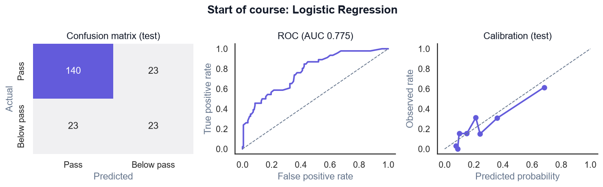
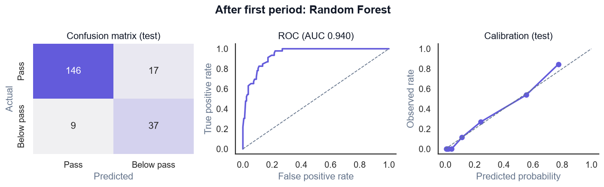
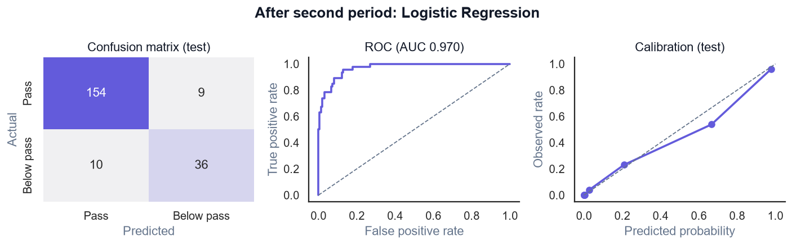

# EduPredict model report

> Generated by `python -m ml.train`. Do not edit by hand.

**Version:** `1.0.0+32f636d9.20261108095008`  
**Trained:** 2026-11-08T09:50:08+00:00  
**Dataset:** Student Performance (CC BY 4.0), DOI 10.24432/C5TG7T  
**Target:** The classifier estimates the probability that a student's final grade in a course (G3) will be below 10 out of 20, the pass mark in this dataset. The regressor estimates the final grade itself. Neither predicts dropout: the dataset has no dropout label, and a final grade of 0 does not establish that a student left school.

## Splits

| Split | Rows | Student groups | Below-pass rate |
| --- | --- | --- | --- |
| train | 626 | 397 | 22.0% |
| validation | 209 | 133 | 22.0% |
| test | 209 | 132 | 22.0% |

## Results on the held-out test set

Positive class: final grade below the pass mark. The threshold was tuned on validation data, and the baseline uses no features.

| Stage | Algorithm | Threshold | Accuracy | Precision | Recall | F1 | ROC-AUC | PR-AUC | Brier | Baseline PR-AUC |
| --- | --- | --- | --- | --- | --- | --- | --- | --- | --- | --- |
| Start of course | Logistic Regression | 0.31 | 0.7799 | 0.5 | 0.5 | 0.5 | 0.7753 | 0.5452 | 0.138 | 0.2201 |
| After first period | Random Forest | 0.35 | 0.8756 | 0.6852 | 0.8043 | 0.74 | 0.9403 | 0.8128 | 0.0855 | 0.2201 |
| After second period | Logistic Regression | 0.52 | 0.9091 | 0.8 | 0.7826 | 0.7912 | 0.9703 | 0.9161 | 0.0589 | 0.2201 |

| Stage | Algorithm | MAE | MSE | RMSE | R² | MAE without G3=0 | 80% interval (±) | Interval coverage | Baseline RMSE |
| --- | --- | --- | --- | --- | --- | --- | --- | --- | --- |
| Start of course | Gradient Boosting | 2.4384 | 10.7474 | 3.2783 | 0.3233 | 2.1828 | 4.02 | 78.0% | 3.9876 |
| After first period | Random Forest | 1.3595 | 4.3995 | 2.0975 | 0.723 | 1.1638 | 1.77 | 75.6% | 3.9876 |
| After second period | Random Forest | 0.793 | 1.7375 | 1.3181 | 0.8906 | 0.7307 | 1.16 | 81.3% | 3.9876 |

## Cost of excluding sensitive features

The same algorithm refitted with every excluded column, scored for comparison only. This variant is never saved or served.

| Stage | Deployed PR-AUC | All-features PR-AUC | Deployed RMSE | All-features RMSE |
| --- | --- | --- | --- | --- |
| Start of course | 0.5452 | 0.5334 | 3.2783 | 3.3027 |
| After first period | 0.8128 | 0.8248 | 2.0975 | 2.0843 |
| After second period | 0.9161 | 0.8582 | 1.3181 | 1.3193 |

## Stage detail: Start of course

No grades yet. Uses only study habits, history and support.

### Classifier comparison (validation split)

| Algorithm | CV PR-AUC | ± | Val PR-AUC | Val ROC-AUC | Val F1@0.5 | Selected |
| --- | --- | --- | --- | --- | --- | --- |
| Logistic Regression | 0.5188 | 0.0828 | 0.5326 | 0.7531 | 0.375 | yes |
| Decision Tree | 0.4319 | 0.0458 | 0.453 | 0.7409 | 0.4762 |  |
| Random Forest | 0.5147 | 0.0457 | 0.4777 | 0.7597 | 0.3529 |  |
| Gradient Boosting | 0.4973 | 0.0694 | 0.4955 | 0.7509 | 0.4242 |  |

### Regressor comparison (validation split)

| Algorithm | CV RMSE | ± | Val MAE | Val RMSE | Val R² | Selected |
| --- | --- | --- | --- | --- | --- | --- |
| Ridge Regression | 3.4937 | 0.1854 | 2.4674 | 3.3701 | 0.2127 |  |
| Decision Tree | 3.3901 | 0.2219 | 2.4575 | 3.2456 | 0.2698 |  |
| Random Forest | 3.3609 | 0.196 | 2.4452 | 3.2381 | 0.2731 |  |
| Gradient Boosting | 3.3331 | 0.1792 | 2.4078 | 3.2263 | 0.2784 | yes |

### What happened to students in each risk band (test)

| Band | Students | Observed below-pass rate |
| --- | --- | --- |
| low | 163 | 14.1% |
| moderate | 27 | 37.0% |
| high | 19 | 68.4% |

### Fairness audit (test)

| Attribute | Group | n | Below-pass rate | Flagged | Recall | FPR | Grade MAE | Small sample |
| --- | --- | --- | --- | --- | --- | --- | --- | --- |
| sex | Female | 134 | 0.2239 | 0.2164 | 0.4333 | 0.1538 | 2.4074 |  |
| sex | Male | 75 | 0.2133 | 0.2267 | 0.625 | 0.1186 | 2.4937 | yes |
| address | Urban | 161 | 0.1739 | 0.2298 | 0.5714 | 0.1579 | 2.2962 | yes |
| address | Rural | 48 | 0.375 | 0.1875 | 0.3889 | 0.0667 | 2.9153 | yes |
| parental_education | Parent with secondary or higher education | 106 | 0.1887 | 0.1792 | 0.55 | 0.093 | 2.7759 | yes |
| parental_education | Parents below secondary education | 103 | 0.2524 | 0.2621 | 0.4615 | 0.1948 | 2.091 | yes |
| school | Gabriel Pereira | 153 | 0.1699 | 0.2484 | 0.6923 | 0.1575 | 2.4285 | yes |
| school | Mousinho da Silveira | 56 | 0.3571 | 0.1429 | 0.25 | 0.0833 | 2.4653 | yes |

## Stage detail: After first period

Adds the first period grade (G1).

### Classifier comparison (validation split)

| Algorithm | CV PR-AUC | ± | Val PR-AUC | Val ROC-AUC | Val F1@0.5 | Selected |
| --- | --- | --- | --- | --- | --- | --- |
| Logistic Regression | 0.8125 | 0.0569 | 0.8037 | 0.9492 | 0.7955 |  |
| Decision Tree | 0.7673 | 0.0416 | 0.7748 | 0.953 | 0.7755 |  |
| Random Forest | 0.8142 | 0.0348 | 0.8062 | 0.9512 | 0.7381 | yes |
| Gradient Boosting | 0.8188 | 0.0272 | 0.7753 | 0.9511 | 0.6494 |  |

### Regressor comparison (validation split)

| Algorithm | CV RMSE | ± | Val MAE | Val RMSE | Val R² | Selected |
| --- | --- | --- | --- | --- | --- | --- |
| Ridge Regression | 2.1936 | 0.1476 | 1.4525 | 2.1685 | 0.674 |  |
| Decision Tree | 2.0798 | 0.2226 | 1.3377 | 2.0061 | 0.721 |  |
| Random Forest | 2.0034 | 0.2062 | 1.2885 | 1.9272 | 0.7425 | yes |
| Gradient Boosting | 2.0231 | 0.1238 | 1.3565 | 1.9991 | 0.723 |  |

### What happened to students in each risk band (test)

| Band | Students | Observed below-pass rate |
| --- | --- | --- |
| low | 155 | 5.8% |
| moderate | 15 | 46.7% |
| high | 39 | 76.9% |

### Fairness audit (test)

| Attribute | Group | n | Below-pass rate | Flagged | Recall | FPR | Grade MAE | Small sample |
| --- | --- | --- | --- | --- | --- | --- | --- | --- |
| sex | Female | 134 | 0.2239 | 0.2687 | 0.7333 | 0.1346 | 1.44 |  |
| sex | Male | 75 | 0.2133 | 0.24 | 0.9375 | 0.0508 | 1.2158 | yes |
| address | Urban | 161 | 0.1739 | 0.2174 | 0.7857 | 0.0977 | 1.2061 | yes |
| address | Rural | 48 | 0.375 | 0.3958 | 0.8333 | 0.1333 | 1.8741 | yes |
| parental_education | Parent with secondary or higher education | 106 | 0.1887 | 0.2264 | 0.8 | 0.093 | 1.456 | yes |
| parental_education | Parents below secondary education | 103 | 0.2524 | 0.2913 | 0.8077 | 0.1169 | 1.2603 | yes |
| school | Gabriel Pereira | 153 | 0.1699 | 0.2222 | 0.7692 | 0.1102 | 1.3888 | yes |
| school | Mousinho da Silveira | 56 | 0.3571 | 0.3571 | 0.85 | 0.0833 | 1.2797 | yes |

## Stage detail: After second period

Adds both period grades (G1 and G2).

### Classifier comparison (validation split)

| Algorithm | CV PR-AUC | ± | Val PR-AUC | Val ROC-AUC | Val F1@0.5 | Selected |
| --- | --- | --- | --- | --- | --- | --- |
| Logistic Regression | 0.9237 | 0.0161 | 0.9238 | 0.9723 | 0.8333 | yes |
| Decision Tree | 0.9128 | 0.0112 | 0.8518 | 0.9617 | 0.8172 |  |
| Random Forest | 0.9255 | 0.0122 | 0.9078 | 0.9732 | 0.809 |  |
| Gradient Boosting | 0.9292 | 0.013 | 0.9041 | 0.9682 | 0.7912 |  |

### Regressor comparison (validation split)

| Algorithm | CV RMSE | ± | Val MAE | Val RMSE | Val R² | Selected |
| --- | --- | --- | --- | --- | --- | --- |
| Ridge Regression | 1.6684 | 0.179 | 0.8723 | 1.3216 | 0.8789 |  |
| Decision Tree | 1.636 | 0.1868 | 0.8244 | 1.2953 | 0.8837 |  |
| Random Forest | 1.5573 | 0.2205 | 0.8052 | 1.1728 | 0.9047 | yes |
| Gradient Boosting | 1.556 | 0.1896 | 0.816 | 1.2105 | 0.8984 |  |

### What happened to students in each risk band (test)

| Band | Students | Observed below-pass rate |
| --- | --- | --- |
| low | 164 | 6.1% |
| moderate | 6 | 33.3% |
| high | 39 | 87.2% |

### Fairness audit (test)

| Attribute | Group | n | Below-pass rate | Flagged | Recall | FPR | Grade MAE | Small sample |
| --- | --- | --- | --- | --- | --- | --- | --- | --- |
| sex | Female | 134 | 0.2239 | 0.2313 | 0.8333 | 0.0577 | 0.7955 |  |
| sex | Male | 75 | 0.2133 | 0.1867 | 0.6875 | 0.0508 | 0.7885 | yes |
| address | Urban | 161 | 0.1739 | 0.1739 | 0.75 | 0.0526 | 0.7958 | yes |
| address | Rural | 48 | 0.375 | 0.3542 | 0.8333 | 0.0667 | 0.7836 | yes |
| parental_education | Parent with secondary or higher education | 106 | 0.1887 | 0.1887 | 0.8 | 0.0465 | 0.813 | yes |
| parental_education | Parents below secondary education | 103 | 0.2524 | 0.2427 | 0.7692 | 0.0649 | 0.7724 | yes |
| school | Gabriel Pereira | 153 | 0.1699 | 0.1634 | 0.7308 | 0.0472 | 0.789 | yes |
| school | Mousinho da Silveira | 56 | 0.3571 | 0.3571 | 0.85 | 0.0833 | 0.8039 | yes |

## Limitations

- Trained on two Portuguese secondary schools, 2005-2006. Results may not transfer to other countries, grading systems, age groups or decades without retraining and local validation.
- The models predict a final grade below the pass mark. They do not predict dropout, ability or potential.
- Associations are not causes. A listed contributing factor shows what moved this estimate, not why a student is struggling or what would change the outcome.
- Historical data can encode bias. Removing protected attributes does not remove it, because other inputs can act as proxies. See the fairness audit for measured differences by group.
- Some records have a final grade of 0 after a non-zero second period grade. The dataset does not explain them, and they make final grades harder to predict.
- Study time, activities and aspirations are self-reported and absences come from school records, so input quality varies.
- Fairness audit groups are small, so differences between groups have wide uncertainty.
- Predictions are decision support for educators and must never be the sole basis for a decision about a student.
